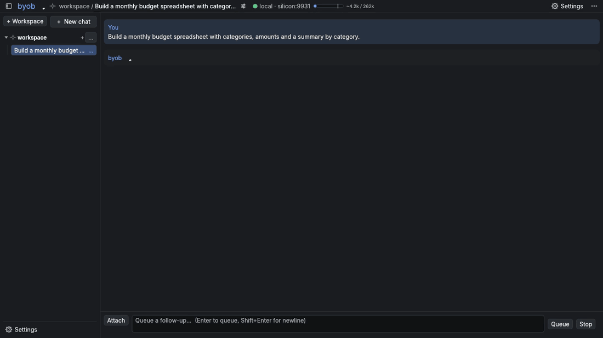
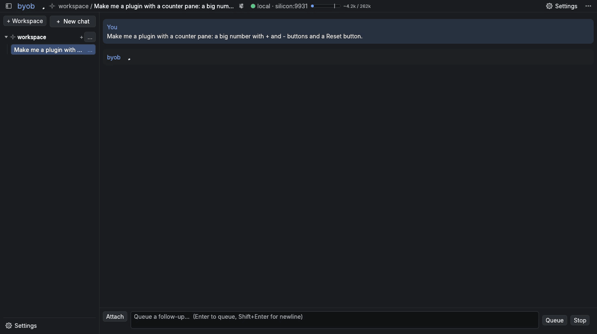
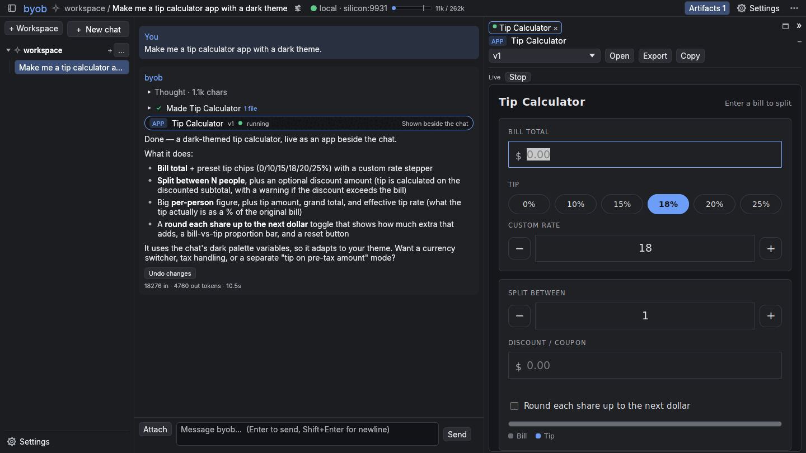
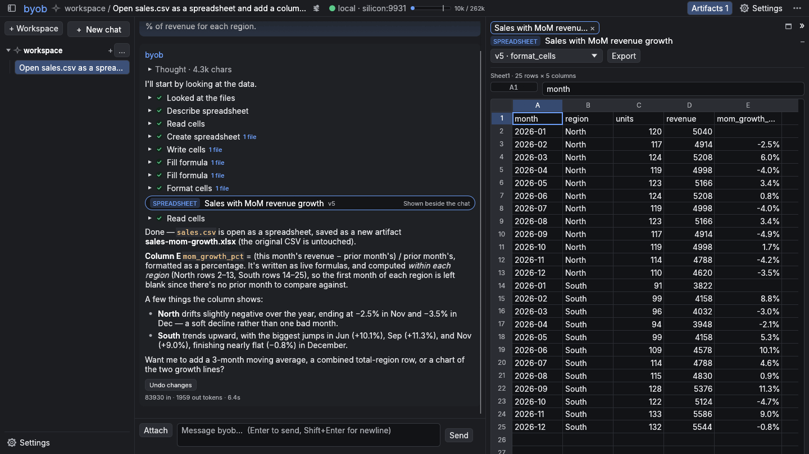
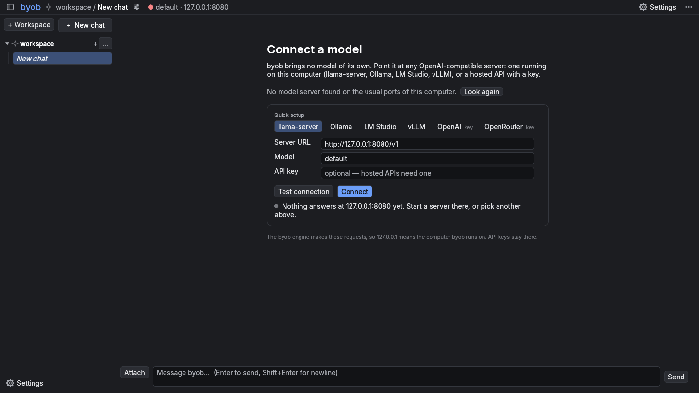
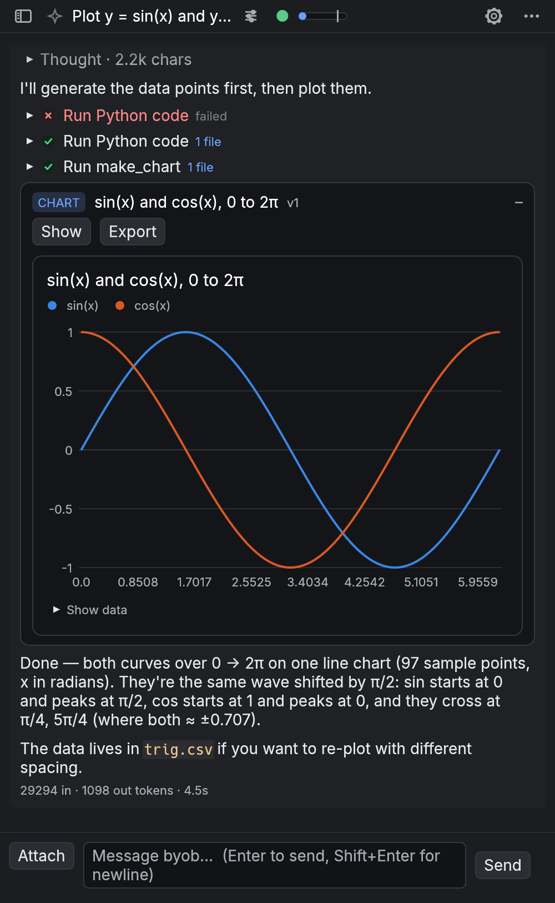

> [!NOTE]
> Heads up: this project, README included, is influenced heavily by AI agents. If LLM-flavoured
> prose isn't your thing, fair warning. Human-written docs will come once things settle.

# bring your own brain

**A native desktop AI coworker for the model you already run.** Point byob at any
OpenAI-compatible endpoint (llama-server, Ollama, LM Studio, vLLM or a hosted API) and it works
in a folder with you: reads and writes files, runs code, and builds spreadsheets, charts,
documents and small apps beside the chat.

byob is **desktop software, not a web page in a window**: one program for Linux, macOS and Windows
that draws its own interface on the GPU, with no Electron.



<sub>Recorded live against a local model (llama.cpp); the waits for the model are cut.</sub>

## What it does

- **A real desktop app.** One folder, about a 60 MB download with everything in it (13 MB for
  the slim build), and native file dialogs, drag and drop and keyboard shortcuts. The browser UI is the reverse of the usual arrangement: the same native interface
  compiled to WebAssembly, so a tab or your phone gets the identical app, live on the same session.
- **Your model, your machine.** No bundled inference and no account: any OpenAI-compatible URL.
  First run finds local servers on their usual ports; tool calling falls back to prompt-based
  calls when the server has none.
- **Artifacts beside the chat.** Spreadsheets (xlsx/csv), charts, Markdown documents,
  images and HTML apps, each with its version history.
- **Hands, with a leash.** File tools, `run_command` and `run_python` in a sandbox; approval
  cards with diffs; undo per turn.
- **Workspaces.** A folder with its own settings and where commands run: this machine, a Nix dev
  shell or a Docker/Podman container. Settings layer global → workspace → chat.
- **Everywhere you are.** `byob --serve` opens that session to browsers too; with
  `tailscale serve` it's on your phone.
- **Everything is a plugin.** The prompt, the core tools, artifacts, spreadsheets, subagents and
  compaction are bundled plugins on the same API anyone gets. Plugins add tools, draw UI (panes,
  header chips, settings, cards), hook every stage of a turn, and run long-lived backends. byob
  can write and fix its own plugins from a chat.

<table>
  <tr>
    <td width="50%"><br><sub>“Make me a plugin with a counter pane”: byob writes it, reads its own load errors, fixes them, and the pane appears.</sub></td>
    <td width="50%"><br><sub>HTML apps run inline, on the desktop (a separate Servo renderer process ships with byob) and in the browser UI.</sub></td>
  </tr>
  <tr>
    <td width="50%"><br><sub>Open a CSV as a spreadsheet; every write recalculates and reports errors back to the model.</sub></td>
    <td width="50%"><br><sub>First run: pick a server it found, or a preset.</sub></td>
  </tr>
</table>

<p align="center"><br><sub>The browser UI at phone width.</sub></p>

## Install

```sh
cargo install byob                          # with the browser UI built in
cargo install byob --no-default-features    # slim: desktop only, a few MB smaller
nix build github:Scronkfinkle/byob          # or .#byob-slim
```

Release archives for Linux, macOS and Windows are on the
[releases page](https://github.com/Scronkfinkle/byob/releases): `byob-…` has everything (the
browser UI and `byob-artifact-host`, which draws HTML apps inline; keep it next to `byob`), and
`byob-slim-…` is byob alone. `cargo install` doesn't build the renderer; without it, HTML apps
open in your browser with one click. On Linux byob needs no GUI toolkit (file dialogs go through
the XDG desktop portal or zenity; without either, drop files onto the window), and the renderer
draws with the system's OpenGL (Mesa).

## Use

```sh
byob                                        # desktop window
byob --serve                                # + browser UI on http://127.0.0.1:7470
byob --headless                             # browser UI only, no window
byob --inference-url http://host:8080/v1 --model local
BYOB_API_KEY=sk-... byob                    # for hosted endpoints
byob --workspace ~/projects/taxes           # start in the workspace for that folder

tailscale serve 7470                        # reach it from any device on your tailnet
byob --headless --allow-user you@example.com # only admit that Tailscale login
```

On first run byob shows **Connect a model**: servers it found on this computer's usual ports
(llama-server 8080, Ollama 11434, LM Studio 1234, vLLM 8000), presets for those and for hosted
APIs, and a Test connection button. Later, the connection lives at the top of Settings (or click
the status dot in the header).

Chats are grouped by **workspace**. **+ Workspace** makes one (a fresh folder or an existing
one) and picks where commands run. A workspace's `…` menu and the sliders next to a chat's title
show what's inherited and what's set there: model, approvals, tool calling, compaction,
subagents, extra instructions.

## Plugins

Settings → Plugins lists what the chat in view can use. Any bundled plugin can be forked to your
own plugins and edited (**Fork to edit**), or just ask byob to change or write one: it has
authoring tools, and a broken plugin's errors come back to the model so it can fix it.

- [docs/views.md](docs/views.md): view trees, the UI plugins draw (panes, chips, cards, grids).
- [docs/plugins-backend.md](docs/plugins-backend.md): long-lived backends (Python or Rust) and hooks.
- [docs/environments.md](docs/environments.md): where commands run, and adding your own.
- [demos/](demos/README.md): hands-on tours, each in a throwaway profile (`demos/run.sh todo`).
- [examples/plugins/todo-demo](examples/plugins/todo-demo): a small plugin with a backend, a pane and cards to copy from.

## Develop

```sh
nix develop          # or: direnv allow
cargo run -p byob    # launch the app
cargo xtask web      # build the browser UI; the next `cargo build` embeds it
cargo xtask ci       # full gate: fmt, clippy, tests, layers, no-tokio, wasm
nix build            # release package (byob + bundled web UI + the artifact host)

# HTML artifacts inline on the desktop: the Servo helper is its own workspace (AGENTS.md §3)
(cd host/artifact-host && cargo build --release)   # scripts/headless.sh picks it up

# desktop GUI on a virtual display, scripted, with a screenshot (HEADLESS_RECORD=x.mp4 records it)
scripts/headless.sh --inference-url http://localhost:8080/v1 --model local --send "hi" --screenshot /tmp/byob.png
scripts/readme-media.sh                            # regenerate this README's pictures

# live test against a real server
BYOB_LIVE_URL=http://localhost:8080/v1 cargo test -p byob-llm -- --ignored
```

See [AGENTS.md](AGENTS.md) for the rules, [docs/architecture.md](docs/architecture.md) for the
design and [ROADMAP.md](ROADMAP.md) for what's next. byob began as a rewrite of hob, an
earlier desktop coworker that bundled llama.cpp; byob drops the bundled inference.

Licensed under MIT OR Apache-2.0.
